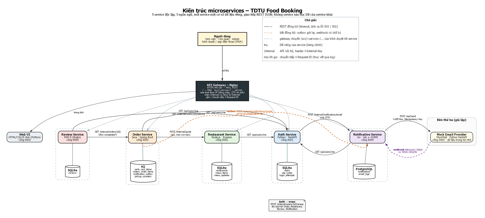
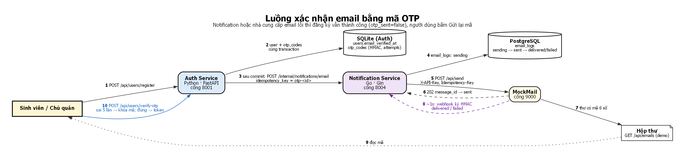

# Kiến trúc

## Tổng quan: 5 service, 5 ngôn ngữ (+ 1 nhà cung cấp email giả lập)



Ảnh trên (`docs/diagrams/arch/ARCH_0_microservices.png`, sinh bằng `python docs/diagrams/gen_diagrams.py`) vẽ đủ 5 service,
5 CSDL riêng, các lời gọi REST giữa service, outbox, gửi email qua MockMail và webhook ký HMAC. Bản chữ:

```
 Trình duyệt ──HTTP──> Web UI :8000 (Python, HTML/CSS/JS tĩnh + /config.js)
      │
      │  fetch + Bearer token (CORS) + X-Request-ID
      ▼
 ┌──────────────┐ ┌──────────────────┐ ┌──────────────────┐ ┌───────────────────┐ ┌──────────────┐
 │ Auth :8001   │ │ Restaurant :8002 │ │ Order :8003      │ │ Notification :8004│ │ Review :8005 │
 │ Python       │ │ Node.js          │ │ Java             │ │ Go                │ │ PHP          │
 │ FastAPI      │ │ Express 5        │ │ Spring Boot 3.5  │ │ Gin + GORM        │ │ thuần + PDO  │
 │ SQLite       │ │ SQLite node:sqlite│ │ H2 (tệp)         │ │ PostgreSQL        │ │ SQLite       │
 │ auth.db      │ │ restaurant.db    │ │ order.mv.db      │ │ notifications,    │ │ review.db    │
 │ (otp_codes)  │ │                  │ │                  │ │ email_logs        │ │              │
 └─────▲──┬─────┘ └──────▲───────────┘ └──┬───┬───▲───────┘ └───▲─────┬───▲─────┘ └──────┬───────┘
       │  │ /api/users/me │ /internal/quote│   │   │ /internal/orders/{id}  │   │         │
       └──┼─ 4 service còn lại xác thực token ┘  │   └─────────────│──────────│───│─────────┘
          │                                    └── outbox ──> /internal/notifications/events
          └── /internal/notifications/email (mã OTP) ───────────────┘      │   │ webhook ký HMAC
                                                                           ▼   │
                                                           MockMail :9000 (Python, giả lập nhà cung cấp email)
```

| Service | Thành viên | Ngôn ngữ / framework | CSDL | Mã nguồn |
| --- | --- | --- | --- | --- |
| Auth | TV1 | Python 3.11+ / FastAPI, Pydantic, PyJWT, bcrypt | SQLite | `services/auth`, `common/` |
| Restaurant | TV2 | Node.js 22+ / Express 5 | SQLite qua `node:sqlite` (có sẵn trong Node) | `services/restaurant` |
| Order | TV3 | Java 17+ / Spring Boot 3.5.6 (Web, JDBC) | H2 dạng tệp (`DATA_DIR/order.mv.db`) | `services/order` |
| Notification | TV4 | Go 1.22+ / Gin 1.10, GORM 1.25 | PostgreSQL 14+ | `services/notification` |
| Review | TV5 | PHP 8.1+ (không framework, `php -S`) | SQLite qua PDO | `services/review` |
| MockMail (bên thứ ba giả lập) | – | Python / FastAPI | Bộ nhớ (mất khi tắt) | `services/mock_email` |

- Mỗi service là một tiến trình độc lập ở cổng riêng, sở hữu CSDL riêng. Không service nào đọc CSDL của service khác;
  dữ liệu khác service chỉ lấy qua REST JSON. ID là UUID dạng chuỗi ở mọi service.
- Các service khác ngôn ngữ nhưng dùng **cùng một hợp đồng**: cùng tệp `.env`, cùng định dạng lỗi, cùng quy tắc ánh xạ
  lỗi khi gọi nhau, cùng CORS, cùng phân trang, cùng `/health`, `/docs`, `/redoc`, `/openapi.json`, cùng `X-Request-ID`.
  Hợp đồng được kiểm bằng test hộp đen trên tiến trình thật (`tests/integration/test_contract.py`).
- MockMail đóng vai **nhà cung cấp email bên ngoài** (như SendGrid, Mailgun): không thuộc 5 service nghiệp vụ, không
  dùng `INTERNAL_KEY`, có khóa API riêng (`EMAIL_API_KEY`) và gọi ngược về hệ thống bằng webhook có chữ ký
  (`EMAIL_WEBHOOK_SECRET`). Thư không gửi ra Internet, chỉ lưu trong bộ nhớ để xem qua `GET /api/emails`.
- `web/server.py` (Python) phục vụ giao diện và sinh `/config.js` chứa địa chỉ các service.
- `manage.py` (Python) là công cụ vận hành chung: kiểm tra môi trường, build, chạy/dừng 7 tiến trình, seed qua API.

Sơ đồ chi tiết: `docs/diagrams/arch/ARCH_1_otp_flow.png` (luồng OTP), `docs/diagrams/dfd/DFD_1_tong_the.png`
(luồng dữ liệu), `docs/diagrams/erd/ERD_0_tong_the.png` (dữ liệu).

## Hợp đồng chung giữa các service

| Mục | Quy ước (giống nhau ở cả 5 ngôn ngữ) |
| --- | --- |
| Cấu hình | Biến môi trường, rồi tệp `.env` ở thư mục gốc (`TDTU_ENV_FILE` để đổi). Thiếu `INTERNAL_KEY` → Node/Java/Go dừng khi khởi động; PHP trả 500 `CONFIG_ERROR` cho mọi request |
| Cổng | Lấy từ `<TÊN>_URL` của chính service; địa chỉ bind `BIND_HOST` (mặc định 127.0.0.1) |
| Lỗi | `{"detail": "<tiếng Việt>", "code": "<MÃ>"}`; 422 thêm `errors: [{field, message}]`; JSON hỏng → 422 "JSON gửi lên không hợp lệ"; 404 `NOT_FOUND`; mọi 401 có header `WWW-Authenticate: Bearer` |
| Dữ liệu vào | Kiểm tra chặt: trường lạ bị chặn, chuỗi cắt khoảng trắng, số nguyên phải là số nguyên JSON thật (1.5, "2", true bị từ chối) |
| Xác thực | `Authorization: Bearer` → gọi Auth `GET /api/users/me`; 401/403 của Auth được chuyển tiếp nguyên mã |
| Nội bộ | `/internal/*` (Restaurant, Order, Notification) chỉ nhận `X-Internal-Key`, so sánh hằng thời gian (`crypto.timingSafeEqual`, `MessageDigest.isEqual`, `subtle.ConstantTimeCompare`); Auth và Review chỉ gửi khóa khi gọi đi. Ngoại lệ duy nhất: webhook `/internal/webhooks/email-status` của Notification xác thực bằng chữ ký HMAC (xem dưới) |
| Gọi service khác | Timeout `HTTP_TIMEOUT`; không kết nối/quá giờ → 503 `UPSTREAM_UNAVAILABLE`; 5xx → 502 `UPSTREAM_ERROR`; không phải JSON → 502 `UPSTREAM_BAD_RESPONSE`; 4xx ngoài dự kiến → 502 `UPSTREAM_REJECTED` |
| Truy vết | Header `X-Request-ID` (xem mục "Truy vết một yêu cầu") |
| CORS | Chỉ origin trong `CORS_ORIGINS`; preflight cho phép `Authorization, Content-Type, Idempotency-Key, X-Request-ID`; trình duyệt đọc được header `X-Request-ID` (Order thêm `Idempotent-Replay`) |
| Phân trang | `page` (≥1), `page_size` (1–100) → `{items, total, page, page_size}` |
| Thời gian | Chuỗi ISO 8601 UTC đến giây: `2026-10-07T03:00:00Z` |
| Tiền | VND, số nguyên (không dùng số thực) |

## Xác thực và phân quyền

1. Auth (Python) ký JWT HS256 (`sub`, `role`, `ver`, `iss`, `iat`, `exp`), hạn `TOKEN_HOURS` giờ, khóa `JWT_SECRET`.
   Chỉ Auth biết `JWT_SECRET`; 4 service còn lại không tự giải mã token.
2. Lấy token: `POST /api/users/login` (JSON, giao diện web dùng) hoặc `POST /api/users/token` (form OAuth2
   `username` = email, `password`; nút **Authorize** của Swagger dùng, Unit 18). Hai endpoint chung một hàm `_login`
   nên cùng giới hạn sai mật khẩu và cùng mã lỗi. Swagger của Auth có 2 cách: đăng nhập bằng form (`OAuth2PasswordBearer`)
   hoặc dán token có sẵn (`HTTPBearer`).
3. Service khác nhận `Authorization: Bearer …`, gọi Auth `GET /api/users/me`. Auth kiểm tra chữ ký, hạn, issuer,
   `ver == users.token_version`, trạng thái tài khoản. Vì vậy khóa tài khoản, đổi vai trò hay đăng xuất có hiệu lực
   ngay ở mọi service, ở mọi ngôn ngữ.
4. Mỗi endpoint kiểm tra vai trò và quyền trên đối tượng (chủ quán của quán/đơn, người đặt đơn).
   Ẩn nút trên giao diện chỉ để tiện dùng; backend luôn tự kiểm tra.

### Vì sao gọi Auth ở mỗi request thay vì JWT RS256 tự kiểm (Phụ lục C)

Phụ lục C của giáo trình gợi ý Auth ký token bằng **RS256**: Auth giữ khóa bí mật, các service khác lấy khóa công khai
và tự kiểm chữ ký, không cần gọi Auth. Nhóm chọn cách khác có chủ đích:

| | Gọi Auth `/api/users/me` mỗi request (đang dùng) | RS256, mỗi service tự kiểm token |
| --- | --- | --- |
| Thu hồi token | **Ngay lập tức**: đăng xuất, đổi mật khẩu, khóa tài khoản, đổi vai trò tăng `token_version` → token cũ bị từ chối ở cả 5 service ở request kế tiếp | Token còn hạn vẫn hợp lệ đến khi hết `exp`; muốn thu hồi phải có danh sách thu hồi chung hoặc token rất ngắn hạn |
| Vai trò / trạng thái | Luôn đọc từ CSDL Auth (mới nhất) | Đọc từ claim trong token (có thể đã cũ) |
| Bí mật | Chỉ Auth giữ `JWT_SECRET`; 4 ngôn ngữ còn lại không phải cài thư viện JWT | Mỗi service (Node, Java, Go, PHP) phải cài thư viện JWT, cấu hình issuer / thuật toán đúng như nhau |
| Chi phí | Thêm 1 lời gọi HTTP nội bộ mỗi request (localhost, vài ms) | Không gọi mạng, chỉ tốn CPU kiểm chữ ký |
| Phụ thuộc | Auth sập → các API cần đăng nhập trả 503 `UPSTREAM_UNAVAILABLE` (kiểm ở `test_contract.py`) | Auth sập vẫn dùng được token đã cấp |

Đánh đổi: hệ thống demo một máy, số request nhỏ, nên tính đúng khi thu hồi (yêu cầu bảo mật: khóa tài khoản phải có hiệu
lực ngay) quan trọng hơn vài ms độ trễ và việc Auth thành điểm phụ thuộc. Hướng cải tiến khi tải lớn:

1. Auth ký RS256 / ES256 và công bố khóa công khai qua `/.well-known/jwks.json`; access token ngắn hạn (5–15 phút) +
   refresh token (Auth kiểm `token_version` mỗi lần làm mới) → thu hồi chậm tối đa bằng thời hạn access token.
2. Hoặc giữ cách hiện tại nhưng cache kết quả `/api/users/me` theo token vài giây trong từng service, và Auth phát sự
   kiện "token bị thu hồi" để các service xóa cache.

### Vì sao endpoint của Auth viết `def` chứ không `async def` (Unit 3)

FastAPI chạy hàm `def` trong **threadpool**, còn hàm `async def` chạy thẳng trên **event loop** (một luồng). Mọi việc của
Auth đều là thao tác **chặn** (blocking): `sqlite3` (đọc/ghi tệp, `BEGIN IMMEDIATE` có thể chờ khóa), `bcrypt`
(`gensalt()` mặc định 12 vòng, cố ý chậm để chống dò mật khẩu), và `requests` khi gọi Restaurant / Notification. Viết các hàm này bằng
`async def` sẽ chặn event loop: trong lúc một người đăng nhập (băm bcrypt), **mọi** request khác của Auth, kể cả
`/api/users/me` mà 4 service còn lại gọi liên tục, phải đứng chờ. Với `def`, mỗi request chạy ở một luồng riêng, kết nối
SQLite riêng (WAL), nên đăng nhập chậm không làm nghẽn xác thực token.

Ngoại lệ duy nhất là `PUT /api/users/me/avatar` (`async def`): hàm đọc thân request theo từng khúc
(`async for chunk in request.stream()`) để dừng ngay khi vượt 1 MB, rồi đẩy việc ghi tệp sang
`run_in_threadpool(_save_avatar, …)`, nên không có lệnh chặn nào chạy trên event loop.

## Luồng đặt món

1. Sinh viên thêm món (Order, Java): Order gọi Restaurant (Node.js) `POST /internal/quote` kiểm tra quán `active`,
   món thuộc quán, `available`, lấy giá hiện tại.
2. Checkout: Order báo giá lại toàn bộ giỏ, rồi trong **một giao dịch** (H2): khóa dòng giỏ của sinh viên bằng
   `SELECT … FOR UPDATE` (các checkout đồng thời xếp hàng), kiểm tra `Idempotency-Key`, kiểm tra giỏ không đổi, ghi
   `orders` + `order_items` (ảnh chụp tên quán, tên món, đơn giá), xóa giỏ. Đơn tiền mặt ghi sự kiện `order_created`
   vào `notification_outbox` trong cùng giao dịch (đơn VietQR ghi khi đã thanh toán). Lỗi ở bất kỳ bước nào →
   rollback, giỏ còn nguyên. `UNIQUE(user_id, idempotency_key)` chặn trùng ở mức CSDL; nhiều request đồng thời cùng
   khóa thì 1 request tạo đơn (201), các request còn lại nhận lại **đúng đơn đó** (200, header `Idempotent-Replay`).
3. Sau commit, Order gửi sự kiện sang Notification (Go). Thành công → `sent`; lỗi → `failed` + ghi lỗi, luồng nền
   (`ScheduledExecutorService`, chu kỳ `OUTBOX_INTERVAL`) gửi lại với thời gian chờ tăng dần (10 s, 20 s, 40 s … tối đa
   300 s; tối đa 10 lần); admin có nút "Gửi lại ngay". Notification chèn `ON CONFLICT DO NOTHING` theo
   `UNIQUE(event_key, user_id)` (PostgreSQL) nên gửi lại không tạo thông báo trùng. API trả một đơn kèm
   `notification_status` (`none` / `failed` / `pending` / `sent`) để thấy chủ quán đã được báo chưa.
4. Đổi trạng thái: `UPDATE orders SET status=? WHERE id=? AND status=<cũ>`; nếu 0 dòng → 409 `STATUS_CHANGED`
   (2 request đồng thời chỉ 1 thành công, minh họa bằng `scripts/demo_concurrency.py`). Sự kiện tương ứng ghi outbox
   trong cùng giao dịch. Luật chuyển trạng thái là `OrderStatus.canChangeTo` (giữ từ bản Java của TV3).
5. Review (PHP) gọi Order `GET /internal/orders/{id}` để xác minh đơn của sinh viên và đã `completed`;
   `UNIQUE(order_id)` ở SQLite chặn đánh giá trùng kể cả gửi đồng thời.

## Xác nhận email bằng OTP (Unit 20)



Bật bằng `OTP_ENABLED=true` (mặc định trong `.env.example`). Ba bên tham gia, mỗi bên giữ đúng dữ liệu của mình:

| Bên | Giữ gì | Không bao giờ giữ / ghi |
| --- | --- | --- |
| Auth (Python) | `otp_codes`: `code_hash` = HMAC-SHA256(`JWT_SECRET`, `otp:<otp_id>:<mã>`), `expires_at`, `attempts`, `used_at`; `users.email_verified_at` | Mã OTP dạng rõ (không lưu DB, không ghi log) |
| Notification (Go) | `email_logs`: người nhận, `idempotency_key` (`otp-<otp_id>`), `provider_message_id`, trạng thái `sending → sent → delivered / failed` | Mã OTP (chỉ chuyển tiếp cho nhà cung cấp, không lưu, log chỉ có email đã che `sv***@domain`) |
| MockMail | Thư đã gửi (bộ nhớ) | – |

Luồng (đánh số như ảnh ARCH_1):

1. `POST /api/users/register`: trong **một giao dịch** SQLite tạo `users` (`email_verified_at = NULL`) và `otp_codes`
   (mã 6 số từ `secrets.randbelow`, chỉ lưu HMAC). Mã cũ chưa dùng của user bị vô hiệu.
2. **Sau commit** Auth gọi Notification `POST /internal/notifications/email` (`X-Internal-Key`, `X-Request-ID`).
   Notification hoặc nhà cung cấp lỗi → đăng ký vẫn thành công với `otp_sent=false`, người dùng bấm "Gửi lại mã".
   Gọi mạng nằm ngoài giao dịch để không giữ khóa CSDL trong lúc chờ mạng.
3. Notification chèn `email_logs` (`status = sending`) với `ON CONFLICT DO NOTHING` theo `idempotency_key`: Auth gửi lại
   cùng mã thì nhận lại kết quả cũ, không gửi thư lần 2; bản ghi `failed` hoặc `sending` bỏ dở quá 30 giây được giành
   lại bằng `UPDATE … WHERE status …` có điều kiện để gửi lại.
4. Notification gọi MockMail `POST /api/send` (header `X-API-Key`, `Idempotency-Key`, timeout
   `EMAIL_PROVIDER_TIMEOUT`), cũng ngoài giao dịch. Nhận `message_id` → `status = sent`; lỗi → `status = failed` kèm
   `last_error`. Ánh xạ lỗi: không kết nối / quá giờ → 503 `EMAIL_PROVIDER_UNAVAILABLE`; 401/403 → 502
   `EMAIL_PROVIDER_AUTH`; 429 → 503 `EMAIL_PROVIDER_RATE_LIMITED` kèm `Retry-After`; 5xx → 502 `EMAIL_PROVIDER_ERROR`.
5. Một lúc sau MockMail gọi webhook `POST /internal/webhooks/email-status` báo `delivered` hoặc `failed`
   (địa chỉ `bounce*@…` → `failed`, lý do `mailbox_not_found`).
6. Người dùng nhập mã: `POST /api/users/verify-otp`. Trong `BEGIN IMMEDIATE`, Auth **cộng `attempts` trước** bằng
   `UPDATE … WHERE attempts < OTP_MAX_ATTEMPTS` rồi mới so HMAC (`hmac.compare_digest`): nhiều lần thử đồng thời không
   vượt được số lần cho phép. Lỗi chỉ được `raise` **sau** khi ra khỏi khối giao dịch, vì `raise` bên trong sẽ rollback
   và mất lần đếm sai. Đúng mã → `used_at`, `email_verified_at`, trả token như đăng nhập.
7. `POST /api/users/resend-otp`: luôn trả 202 (không lộ email nào đã đăng ký); cách lần trước tối thiểu
   `OTP_RESEND_SECONDS`, tối đa `OTP_RESEND_PER_HOUR` mã mỗi giờ, quá thì 429 kèm `retry_after` và `Retry-After`.
8. Đăng nhập khi chưa xác nhận: 403 `EMAIL_NOT_VERIFIED` (chỉ báo khi **đúng** mật khẩu); giao diện mở ngay ô nhập mã.
   Admin và tài khoản có từ trước khi thêm tính năng được coi là đã xác nhận.

### Chữ ký webhook

MockMail không giữ `INTERNAL_KEY` (bên thứ ba không được biết khóa nội bộ), nên webhook được xác thực bằng chữ ký:

- MockMail gửi header `X-Webhook-Signature: sha256=<hex>` = HMAC-SHA256(`EMAIL_WEBHOOK_SECRET`, **đúng các byte thân
  request**). Notification đọc thân thô (tối đa 16 KB), tính lại HMAC trên chính các byte đó và so bằng `hmac.Equal`
  (hằng thời gian), **trước** khi parse JSON. Ký trên thân thô vì parse rồi serialize lại có thể đổi thứ tự khóa hoặc
  khoảng trắng làm chữ ký lệch. Sai / thiếu chữ ký → 401 `INVALID_SIGNATURE`.
- JSON được kiểm chặt (`DisallowUnknownFields`, `status` chỉ là `delivered` / `failed`).
- Chỉ cho `sent → delivered / failed` bằng `UPDATE … WHERE status = 'sent'`; gửi lại cùng kết quả trả 200, kết quả khác
  sau trạng thái cuối bị bỏ qua (`ignored`). Webhook tới trước khi kịp lưu `message_id` → 404, MockMail thử lại sau
  2, 4, 8 giây.

## Truy vết một yêu cầu (X-Request-ID)

Mỗi request có một mã truy vết, đi qua mọi service mà request đó chạm tới, và xuất hiện ở cuối mọi dòng log dạng `rid=<mã>`:

1. Nhận header `X-Request-ID` nếu khớp `^[A-Za-z0-9._-]{8,128}$`; thiếu hoặc sai → sinh mới (UUID bỏ dấu gạch,
   32 ký tự hex). Không nhận giá trị tùy ý để tránh chèn ký tự xuống dòng giả mạo dòng log.
2. Trả lại trong header response (kể cả response lỗi) và cho trình duyệt đọc qua `Access-Control-Expose-Headers`.
3. Chuyển tiếp nguyên mã khi gọi service khác (Auth `/me`, quote, outbox, email, webhook của MockMail).

| Service | Cách giữ rid trong lúc xử lý |
| --- | --- |
| Auth (Python) | `contextvars` (`common/request_id.py`), đi theo cả hàm `def` chạy trong threadpool; `logging.Filter` gắn vào mọi dòng log |
| Restaurant (Node.js) | `AsyncLocalStorage` (`src/requestId.js`) |
| Order (Java) | SLF4J `MDC` trong filter (`try/finally MDC.remove`), mẫu log `rid=%X{rid}`; luồng outbox nền ghi `rid=-` |
| Notification (Go) | middleware Gin lưu vào context; `accessLog` in rid |
| Review (PHP) | hằng `REQUEST_ID` (mỗi request PHP chạy lại `public/index.php` từ đầu nên hằng chỉ sống trong request đó) |

Ví dụ: đặt đơn tiền mặt kèm `X-Request-ID: demo-rid-0001`, rồi `grep demo-rid-0001 logs/*.log` thấy cùng mã ở
`order.log`, `auth.log` (xác thực token), `restaurant.log` (báo giá), `notification.log` (sự kiện). Kiểm bằng
`tests/integration/test_contract.py::test_request_id_traced_across_services`.

## Đồng thời theo từng runtime

| Service | Mô hình | Cách giữ đúng dữ liệu khi đồng thời |
| --- | --- | --- |
| Auth (Python) | uvicorn, handler `def` chạy trong threadpool (xem mục trên) | Kết nối SQLite riêng mỗi request, WAL, `BEGIN IMMEDIATE`; kiểm tra "admin cuối cùng" trong giao dịch; OTP cộng lần thử bằng `UPDATE` có điều kiện trước khi so mã |
| Restaurant (Node.js) | 1 luồng, event loop; lệnh `node:sqlite` đồng bộ | Mỗi khối giao dịch chạy trọn vẹn không xen kẽ; `BEGIN IMMEDIATE` |
| Order (Java) | Tomcat nhiều luồng, Hikari pool | `SELECT … FOR UPDATE` trên giỏ, `UPDATE … WHERE status=<cũ>`, ràng buộc UNIQUE |
| Notification (Go) | goroutine mỗi request, pool kết nối PostgreSQL | `INSERT … ON CONFLICT DO NOTHING`, cập nhật có điều kiện (outbox sự kiện, `email_logs`, webhook) |
| Review (PHP) | `php -S` (4 worker trên Linux/macOS, 1 trên Windows) | `UNIQUE(order_id)` + `busy_timeout`, bắt lỗi ràng buộc → 409 |
| MockMail (Python) | `async` + threadpool cho phần chặn | Khóa (`threading.Lock`) quanh bảng idempotency trong bộ nhớ: cùng khóa đang gửi → 409 `IDEMPOTENCY_IN_PROGRESS` |

## Cấu hình

Tất cả trong `.env` (mẫu: `.env.example`): `JWT_SECRET`, `INTERNAL_KEY`, `POSTGRES_PASSWORD`, `NOTIFICATION_DB_URL`,
`EMAIL_API_KEY`, `EMAIL_WEBHOOK_SECRET` (bắt buộc; `manage.py init-env` sinh ngẫu nhiên), `TOKEN_HOURS`, `DATA_DIR`,
`*_URL` (cổng lấy từ URL, gồm `MOCK_EMAIL_URL`), `WEB_PORT`, `CORS_ORIGINS`, `HTTP_TIMEOUT`, `OUTBOX_INTERVAL`,
`LOG_LEVEL`. OTP và email: `OTP_ENABLED`, `OTP_TTL_SECONDS`, `OTP_MAX_ATTEMPTS`, `OTP_RESEND_SECONDS`,
`OTP_RESEND_PER_HOUR`, `EMAIL_PROVIDER_URL`, `EMAIL_WEBHOOK_URL`, `EMAIL_PROVIDER_TIMEOUT`,
`MOCK_EMAIL_RATE_PER_MINUTE`. Tệp `.env` cũ thiếu các khóa này được `manage.py` tự thêm vào cuối (lấy giá trị từ
`.env.example`, sinh khóa bí mật mới). Giao diện lấy địa chỉ service từ `/config.js` (ghi đè bằng `PUBLIC_*_URL`
khi truy cập từ máy khác).

## Vận hành

`manage.py start` chạy 7 tiến trình bằng đúng runtime của từng service:

| Tiến trình | Lệnh (cwd) |
| --- | --- |
| auth | `python -m uvicorn services.auth.app:app --no-access-log` (gốc dự án; log truy cập do middleware ghi, có `rid=`) |
| restaurant | `node --disable-warning=ExperimentalWarning src/server.js` (`services/restaurant`) |
| order | `java -jar target/order-service.jar` (`services/order`) |
| notification | `bin/notification-service` (`services/notification`) |
| review | `php -S 127.0.0.1:8005 public/index.php` (`services/review`) |
| mock_email | `python -m uvicorn services.mock_email.app:app --no-access-log` (gốc dự án) |
| web | `python -m uvicorn web.server:app` (gốc dự án) |

PID ghi vào `.run/pids.json`, log vào `logs/<tên>.log`; lệnh chờ `/health` của từng tiến trình (kiểm tra cả kết nối
CSDL), báo dòng log cuối nếu một tiến trình dừng sớm. `manage.py stop` chỉ dừng các PID đã ghi (cả cây tiến trình).
Với Docker Compose, MockMail là container `mock-email` (cổng `127.0.0.1:9000`), không nằm trong `depends_on` của service
nào: MockMail sập thì đăng ký vẫn chạy (`otp_sent=false`).

## Giới hạn đã biết

- SQLite/H2 dạng tệp phù hợp demo một máy; triển khai nhiều máy cần DB server cho cả 5 service.
- Outbox chỉ dùng cho thông báo; nếu Restaurant sập khi checkout, đơn không được tạo (trả 503, giỏ giữ nguyên).
- Token không làm mới tự động (hết hạn sau `TOKEN_HOURS`, đăng nhập lại); mỗi request cần đăng nhập tốn thêm một lời gọi
  Auth (đánh đổi đã nêu ở trên).
- Email OTP gửi qua MockMail giả lập, không gửi thư thật; muốn gửi thật chỉ cần đổi `EMAIL_PROVIDER_URL` /
  `EMAIL_API_KEY` sang nhà cung cấp có cùng kiểu API (và viết lại `buildProviderPayload` nếu khác định dạng).
- MockMail lưu thư và bảng idempotency trong bộ nhớ: khởi động lại là mất.
- `php -S` là máy chủ phát triển của PHP, đủ cho demo; triển khai thật nên dùng PHP-FPM + Nginx/Apache.
- `node:sqlite` của Node.js 22 còn được Node đánh dấu "experimental" (đã tắt cảnh báo khi chạy).
